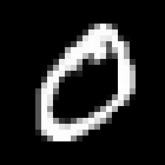
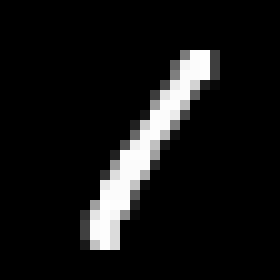
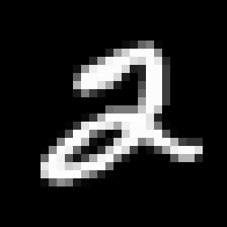
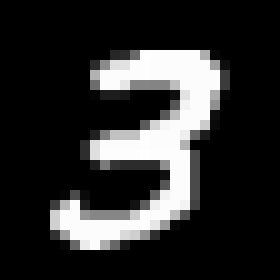
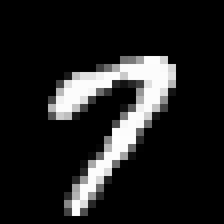
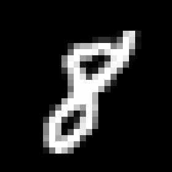

# PRD: Simple neural network (Python)

Status: **draft** — user stories requested. Python code still waits until Vincent asks.

User stories: [user-stories.md](/cursor/stores/self/docs/user-stories.md) (four groups: network structure, MNIST, learning, usage).

Open this file in **Markdown Preview** to see the formulas (not the raw `$…$` source).

## Problem

Vincent wants a very simple neural network in Python so he can learn how it works: a from-scratch two-layer MNIST network.

## Goals

- A small, self-explanatory neural network in **Python** that makes the mechanics visible
- Follow the definition Vincent quoted from his notes (below)
- Train on a small MNIST subset file and print a few digit guesses
- **Priority: keep it simple and self-explanatory** — not accuracy
- Spec-driven delivery (this PRD is the source of truth until stories and code are requested)
- Implementation and tests run on Vincent’s local machine

## Non-goals (until the PRD says otherwise)

- Any language other than Python
- Any Python ML library (PyTorch, TensorFlow, Keras, scikit-learn, JAX, and similar)
- NumPy or other numeric libraries — pure Python only
- Full 60k/10k MNIST training
- User-story decomposition
- Production OCR, GPUs, or a full deep-learning framework
- Any accuracy target, hyperparameter search, or tuning for a score

## Users

- Primary: Vincent, learning how a neural network works by building one

## Reference

- Vincent’s notes for the two-layer MNIST definition quoted below (math and schema only)

## Theory

This section is the teaching core of the PRD. The later Python file should be readable as a walk through of this theory.

### What the network is

A neural network here is **not** a black box. It is two tables of numbers (**weights**) plus two simple math steps (**activations**).

We show it a picture of a handwritten digit. It outputs **10 scores**, one per digit `0`…`9`. The largest score is its guess.

It does not “see” a picture the way we do. The picture is turned into **784 numbers**: each pixel of the 28×28 grid is one number between 0 (white) and 1 (black), laid out in a single row.

So one image is a row vector of length 784. A batch of 150 images is the matrix $X_{150,784}$ from the notes.

### What we want to recognize

The goal is **not** to read a full page or a printed font. It is: given one small handwritten numeral, **name the digit** (`0`…`9`).

Below are a few **real MNIST** examples (originally 28×28 pixels, shown larger). The caption is the true label — what we want the network to output after it looks at that picture.

**True label: 0** — the network should guess `0`.

**True label: 1** — the network should guess `1`.

**True label: 2** — the network should guess `2`.

**True label: 3** — the network should guess `3`.

**True label: 7** — the network should guess `7`.

**True label: 8** — the network should guess `8`.

Handwriting varies (a sloppy `7` vs a crossed `7`, an `8` that looks like a `0`). That is why we train on many examples. After training, we print a few guesses vs these kinds of labels. We do **not** require a score; we want the loop to be obvious.

### A neuron

One **neuron** does two things:

1. **Weighted sum** — multiply each incoming number by a weight, then add those products. That sum is $z$.
2. **Activation** — pass $z$ through a small function $\sigma(z)$ so the output stays in a useful range (not a huge raw sum).

The **weights** are the knobs we will learn. At the start they are random. After training they should make the digit scores match the labels.

This Project has **no bias terms** (no extra “+ b” per neuron), so the theory stays aligned with the two weight matrices only.

### Two layers

- **Layer 1 (hidden):** 32 neurons. Each one looks at all 784 pixels. Together they are a 32-number “internal sketch” of the image: not a digit yet, just features the second layer can use.
- **Layer 2 (output):** 10 neurons. Each one looks at those 32 numbers and votes for one digit class.

So the shapes that actually fit MNIST are:

| object | meaning | shape |
| --- | --- | --- |
| $X$ | 150 images, 784 pixels each | $150 \times 784$ |
| $W^{1}$ | every hidden neuron’s 784 weights | $784 \times 32$ |
| $Z^{1}$ | hidden weighted sums | $150 \times 32$ |
| $LAYER^{1}$ | hidden activations | $150 \times 32$ |
| $W^{2}$ | every output neuron’s 32 weights | $32 \times 10$ |
| $Z^{2}$ | output weighted sums | $150 \times 10$ |
| $\hat{Y}$ | 10 scores per image | $150 \times 10$ |
| $Y$ | true labels, one-hot (a 1 in the true digit column) | $150 \times 10$ |

The notes label the weights $W^{1}_{32,150}$ and $W^{2}_{10,150}$. Those subscripts do not multiply with $X_{150,784}$. We keep the **32 and 10 neurons**, and use **784×32** and **32×10** so the multiplications are valid.

### Forward pass (how a guess is made)

From the notes, with $\sigma$ meaning “an activation” in general:

$$
X \longrightarrow \otimes W^{1} \rightarrow Z^{1} \rightarrow \sigma \rightarrow LAYER^{1} \longrightarrow \otimes W^{2} \rightarrow Z^{2} \rightarrow \sigma \rightarrow \hat{Y} \gg LOSS(\hat{Y}, Y)
$$

In this Project the two $\sigma$ are **different** functions:

1. $Z^{1} = X \cdot W^{1}$
2. $LAYER^{1} = \mathrm{ReLU}(Z^{1})$
3. $Z^{2} = LAYER^{1} \cdot W^{2}$
4. $\hat{Y} = \mathrm{sigmoid}(Z^{2})$

**ReLU** (hidden layer): $\mathrm{ReLU}(z) = \max(0, z)$. Negative sums become 0; positive sums pass through. That is a cheap “on/off” that is easy to differentiate (slope 1 if $z>0$, else 0).

**Sigmoid** (output layer): $\mathrm{sigmoid}(z) = 1 / (1 + e^{-z})$. Each of the 10 numbers is squashed into $(0, 1)$, which we treat as a soft score for that digit. We do **not** force them to sum to 1 (that would be softmax — out of scope). The guess is simply **argmax**: the column with the largest score.

### Loss (how wrong a guess is)

The true label for an image is a **one-hot** row: digit `3` is `[0,0,0,1,0,0,0,0,0,0]`.

**Mean squared error** compares every score to every one-hot entry:

$$
LOSS = (\hat{Y} - Y)^{2}
$$

(summed over the batch in the code). If the network is sure about the right digit, $\hat{Y}$ is close to $Y$ and the loss is small. If it is sure about the wrong digit, the loss is large.

We **do not** chase an accuracy percentage. Loss is only there so the backward pass has a number to reduce.

### Backward pass (how it learns)

Learning is **backpropagation** plus **SGD**. Idea in one sentence: *measure the error at the output, send it backward through each layer, and nudge every weight a little so the next forward pass is less wrong.*

Derivatives we need:

- $\mathrm{sigmoid}'(z) = \sigma(z)\,(1-\sigma(z))$
- $\mathrm{ReLU}'(z) = 1$ if $z>0$, else $0$

$\odot$ is element-wise multiply (Hadamard). $\cdot$ is matrix multiply. $(\cdot)^{\top}$ is transpose.

For one batch:

1. Error at the output (MSE + sigmoid):

$$
E = 2(\hat{Y}-Y) \odot \mathrm{sigmoid}'(Z^{2})
$$

2. How to change the second-layer weights (closer to the answer):

$$
\frac{\partial LOSS}{\partial W^{2}} = (LAYER^{1})^{\top} \cdot E
$$

   Read: “for each of the 32 hidden values, how much did it push each of the 10 output errors?”
3. Send that error back to the hidden layer, through $W^{2}$ and ReLU:

$$
\frac{\partial LOSS}{\partial W^{1}} = X^{\top} \cdot \bigl( (E \cdot (W^{2})^{\top}) \odot \mathrm{ReLU}'(Z^{1}) \bigr)
$$

   Read: “for each of the 784 pixels, how much did it push each of the 32 hidden neurons, given the error that came from the output?”
4. **SGD update** (take a small step downhill; $\eta = 1$):

$$
W^{1} \leftarrow W^{1} - \eta\,\frac{\partial LOSS}{\partial W^{1}}, \quad
W^{2} \leftarrow W^{2} - \eta\,\frac{\partial LOSS}{\partial W^{2}}
$$

No momentum, Adam, or regularization. Repeat: **batch** of 150 images → **epoch** = one full walk through the ~1,000 training images (~7 batches) → **50 epochs**.

That is the whole learning theory for this Project.

## Model definition (from Vincent)

150 observations in a matrix $X_{150,784}$ (2D tensor): 150 rows (observations), 784 columns (features).

Two weight matrices. The notes label them $W^{1}_{32,150}$ and $W^{2}_{10,150}$. **Locked** implementable shapes: $W^{1}$ is $784 \times 32$, $W^{2}$ is $32 \times 10$.

Layers: 1st layer of 32 neurons, 2nd layer of 10 neurons.

Output $OUTPUT_{150,10}$: 150 rows, 10 columns (the 10 digit classes).

Schema: $X \to \otimes W^{1} \to Z^{1} \to \sigma \to LAYER^{1} \to \otimes W^{2} \to Z^{2} \to \sigma \to \hat{Y} \gg LOSS(\hat{Y}, Y)$, with hidden ReLU and output sigmoid.

## Decisions

- **Language:** Python only (standard library). No other languages.
- **Purpose:** learning how a neural network works
- **Stack:** pure Python, from scratch. No ML libraries, no NumPy.
- **Task:** handwritten digit recognition (OCR) on MNIST
- **Done:** one well-commented Python file that trains and can emit digit guesses. **No accuracy objective.** Priority is that a reader can follow the learning loop.
- **Architecture:** 32 neurons then 10 neurons on 784-pixel inputs → **784 → 32 → 10**
- **Weight matrices:** $W^{1}$ is **784×32**, $W^{2}$ is **32×10**
- **Forward / activations / loss / backprop:** as in **Theory** above
- **Prediction:** argmax over the 10 outputs → digit 0–9
- **Subset file:** ~1,000 train / ~200 test
- **Batch:** **150 images per training step**
- **Epochs:** 50, print the loss after each epoch
- **Learning rate:** $\eta = 1$
- **Deliverable:** **one Python file**, well commented so it reads as this theory in code

## Requirements

- Implement from scratch in pure Python (explicit forward pass, loss, backprop).
- Comments should retell the theory above, next to the matching lines.
- No ML libraries, no NumPy, no other languages.
- MNIST subset file for train/eval.
- After training, print digit guesses for some images (no score to hit).
- Two layers, 32 then 10 neurons.
- Ship as a single well-commented `.py` file.

## Success criteria

- The single `.py` file is simple and self-explanatory (comments carry the forward / loss / backward / update story).
- Running it trains the net and prints a few predicted digits vs labels.
- **No accuracy number is required.** We do not tune to hit a %.

## Constraints

- Language: Python (standard library only)
- Code on Vincent’s local machine when we reach implementation
- Process: PRD (here) → [user stories](/cursor/stores/self/docs/user-stories.md) (requested) → code and tests (on request)

## Open questions

None on the model. Stories are in [user-stories.md](/cursor/stores/self/docs/user-stories.md). Python still waits until Vincent asks.
